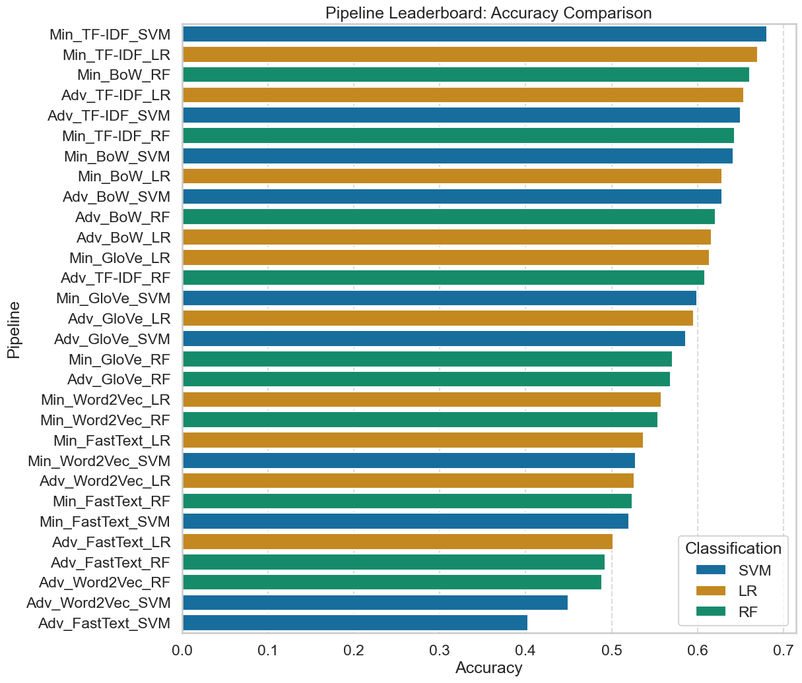
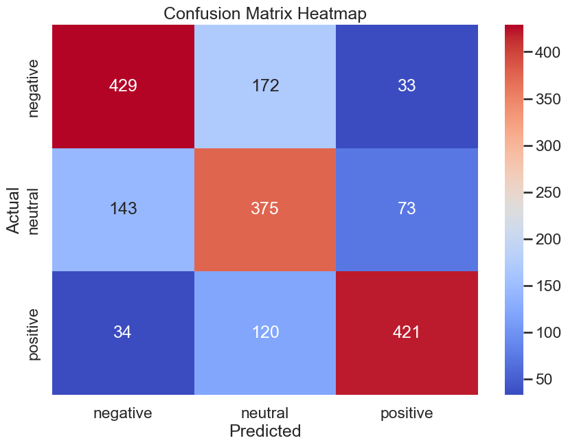
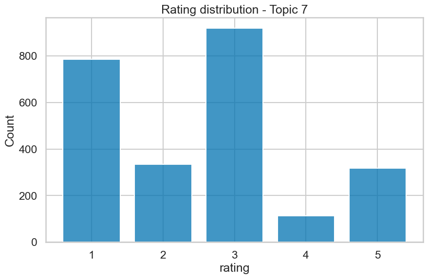
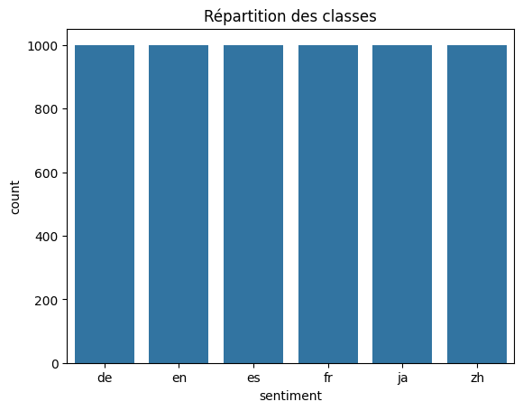

# 🛍️ Amazon Reviews Text Mining & Hybrid Recommender

[](https://www.python.org/)
[](https://scikit-learn.org/)
[](https://www.nltk.org/)
[](https://maartengr.github.io/BERTopic/)
[](#author)

A complete Text Mining pipeline comparing **classical NLP (BoW, TF-IDF)** with **dense embeddings (Word2Vec, GloVe, FastText)** across English and 6-language customer reviews. Includes sentiment classification, topic modeling (LDA vs. BERTopic), and an explainable hybrid recommendation engine.

---

## 🎯 Project Overview

This project analyzes **12,000 Amazon reviews** across two setups:

* **Mono-language (English)**: 6,000 balanced reviews across positive, neutral, and negative classes.
* **Multilingual (6 Languages)**: 6,000 reviews evenly distributed across **English, French, German, Spanish, Chinese, and Japanese** (1,000 each).

```
   Raw Reviews ──► Preprocessing ──► Vectorization ──► Multi-Task Models
   • Mono (EN)     (Min vs Adv)      • BoW / TF-IDF     • Sentiment (SVM/LR/RF)
   • Multi (6L)                      • W2V / GloVe / FT • Topics (LDA / BERTopic)
                                                               │
                                                               ▼
                                                  Hybrid Recommendation Engine
                                                  (Text + Sentiment + Topic)
```

---

## 🏆 Key Results & Benchmarks

We systematically benchmarked **30 pipelines per dataset** ($2 \text{ Preprocessings} \times 5 \text{ Vectorizations} \times 3 \text{ Classifiers}$).

### 1. Top Performing Sentiment Models

| Dataset                  | Best Pipeline            |     Accuracy     |     F1-Score     | Inference Time | Why it Won                                             |
| :----------------------- | :----------------------- | :--------------: | :--------------: | :-------------: | :----------------------------------------------------- |
| **Mono (EN)**      | **Min_TF-IDF_SVM** | **68.06%** | **68.41%** |      9.96s      | SVM handles high-dimensional TF-IDF sparse space best. |
| **Mono Runner-up** | Min_TF-IDF_LR            |      67.00%      |      67.13%      | **1.65s** | Ultra-fast and stable linear baseline.                 |
| **Multi (6L)**     | **Adv_TF-IDF_SVM** | **55.50%** |      47.23%      |      4.00s      | Highest raw accuracy across 6 languages.               |
| **Multi (Fast)**   | **Adv_TF-IDF_LR**  |      53.33%      | **48.33%** | **1.14s** | Most balanced F1-score with real-time speed.           |

> **Key Finding**: Classical **TF-IDF outperformed static embeddings** (Word2Vec, GloVe, FastText) by **+19.6%** in English and **+32.8%** in multilingual classification. Centroid vector averaging dilutes sentiment keywords, whereas TF-IDF cleanly isolates them.

<p align="center">
  
  
</p>
<p align="center"><em>Left: Accuracy across top 30 pipelines (Mono) | Right: Confusion Matrix for best model (Min_TF-IDF_SVM)</em></p>

---

### 2. Topic Modeling (LDA vs. BERTopic)

| Corpus                     | Best Model             | Coherence ($c_v$) |     Runtime     | Highlight                                                      |
| :------------------------- | :--------------------- | :-----------------: | :-------------: | :------------------------------------------------------------- |
| **Mono (EN)**        | **Adv_LDA**      |   **0.448**   | **12.7s** | Preprocessing slashed vocabulary, boosting coherence by +6.7%. |
| **Multi (6L)**       | **Min_LDA**      |   **0.742**   | **5.7s** | High coherence with near-instant convergence.                  |
| **Multi (Semantic)** | **Min_BERTopic** |   **0.737**   |      13.3s      | Superior cross-lingual semantic clustering.                    |

---

## 💡 Hybrid Recommendation Engine

The recommendation engine combines **three complementary signals** to find relevant reviews and suggest alternative products:

$$
\text{Score} = 0.2 \cdot \text{Textual Similarity} + 0.6 \cdot \text{Sentiment Alignment} + 0.2 \cdot \text{Topic Similarity}
$$

* **Textual Similarity (TS)**: Cosine similarity on TF-IDF vectors (exact keyword matching).
* **Sentiment Alignment (SA)**: Custom distance $1 - |x - y|$ mapping polarities to ensure positive queries match positive reviews.
* **Topic Similarity (TM)**: Cosine similarity on LDA/BERTopic topic mixtures (conceptual context).

<p align="center">
  
  
</p>
<p align="center"><em>Left: Identifying defect hotspots (Topic #2 with 78% negative reviews) | Right: Multilingual dataset balance</em></p>

### Practical Application:

When a customer complains about an issue (e.g., *"this phone's battery life is the worst"*):

1. **Defect Tracking**: Identifies similar complaints for quality assurance.
2. **Alternative Suggestion**: Automatically filters for `sentiment == positive` within the same topic to recommend high-rated alternative products with great battery performance.

---

## 🚀 Quick Start

### 1. Installation

```bash
git clone https://github.com/your-username/amazon-reviews-text-mining.git
cd amazon-reviews-text-mining

pip install -r requirements.txt
```

### 2. NLTK Setup

```python
import nltk
nltk.download(['stopwords', 'punkt', 'wordnet'])
```

### 3. Run Notebooks

* [`Notebooks/mono-langue Amazon.ipynb`](<Notebooks/mono-langue%20Amazon.ipynb>) — Monolingual English pipeline.
* [`Notebooks/multilingual Amazon.ipynb`](<Notebooks/multilingual%20Amazon.ipynb>) — Multilingual 6-language pipeline.

*(Optional: GloVe 100d pre-trained embeddings link is provided in [`Embeddings/README.txt`](Embeddings/README.txt).)

---

## 📜 License

MIT License — free for academic and educational use.
